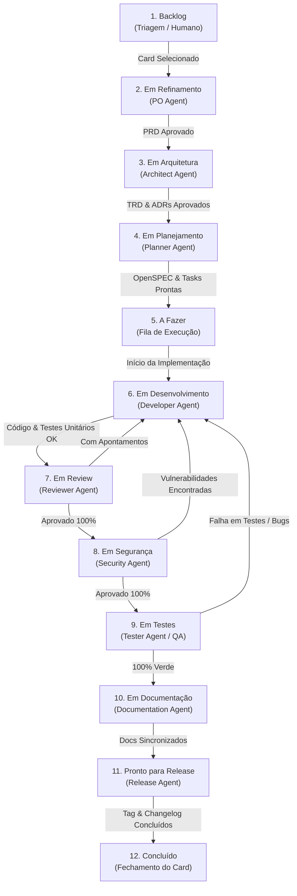

# Regras de Movimentação e Ciclo de Vida dos Cards no Jira

Este documento define as regras estritas de abertura, tipagem e movimentação de status dos cards no Jira, garantindo que **cada etapa do processo seja de responsabilidade de um agente especializado** com critérios de entrada e saída (Definition of Done) bem delimitados.

---

## 1. Regras para Abertura de Cards
- **Cards de História (Story)**: Destinados a contar a história do usuário. Somente podem ser abertos para agrupar épicos.
- **Cards de Épicos (Epic)**: Servem para agrupar as tarefas subdividindo por ação dentro da história.
- **Cards de Tarefas (Task)**: São os cards nos quais os agentes de execução vão se basear, podendo ser para Features ou Bugs.

---

## 2. Mapeamento de Status, Agentes e Transições

O ciclo de vida padrão de qualquer card obedece rigorosamente ao modelo **1 Etapa = 1 Agente Responsável**:

| Ordem | Status Canônico no Jira | Agente Responsável | Artefato de Entrada | Trabalho Executado | Critério de Saída (DoD da Etapa) |
|:---:|:------------------------ |:------------------ |:------------------- |:------------------ |:-------------------------------- |
| **1** | **Backlog** | *Humano / Triage* | Ideia ou Demanda Bruta | Triagem inicial e priorização da demanda | Card aceito para especificação formal |
| **2** | **Em Refinamento** | `po` | Card Bruto | Brainstorming com stakeholder + Regras de negócio | PRD aprovado em `docs/prds/PRD-NNN.md` |
| **3** | **Em Arquitetura** | `architect` | PRD aprovado | Modelagem de dados, limites de sistema e ADRs | TRD atualizado em `docs/trd.md` + ADRs |
| **4** | **Em Planejamento** | `planner` | PRD + TRD | Quebra técnica detalhada e cenários executáveis | OpenSPEC em `docs/specs/` + Tasks no Jira |
| **5** | **A Fazer** | *(Fila de Espera)* | OpenSPEC validado | Aguardando capacidade de desenvolvimento | Alocação do card para o desenvolvedor |
| **6** | **Em Desenvolvimento** | `developer` | OpenSPEC | Implementação do código + testes unitários | Build passando e testes unitários 100% |
| **7** | **Em Review** | `reviewer` | PR / Git Diff | Revisão de padrões, clean code e arquitetura | Aprovação do Review Gate sem ressalvas |
| **8** | **Em Segurança** | `security` | Código em Review | Auditoria SAST, segredos e dependências | Aprovação do Security Gate sem vulnerabilidades |
| **9** | **Em Testes** | `tester` | Branch com build | Suíte hermética completa, lint, tipos e testes | 100% testes verdes (Testing Gate) |
| **10** | **Em Documentação** | `documentation` | Código validado | Atualização de docs, README e referências | Docs sincronizados com a codebase real |
| **11** | **Pronto para Release** | `release` | Docs sincronizados | Versionamento semântico (SemVer), tags e release notes | Tag criada e release notes publicadas |
| **12** | **Concluído** | *Sistema / Release* | Release finalizada | Encerramento do ciclo de vida | Card fechado |

> **Nota de Resolução de IDs de Transição:** Cada espaço e projeto no Jira possui IDs numéricos próprios de status e transições. O agente deve inspecionar as transições disponíveis dinamicamente via MCP Atlassian (`getTransitionsForJiraIssue`) ou REST API (`/rest/api/3/issue/{key}/transitions`) para resolver o ID correspondente ao status canônico desejado.

---

## 3. Regras Operacionais Detalhadas por Etapa

### 2.0 Criação e Preenchimento Obrigatório dos Cards (Nunca Deixar Vazio)
- **Proibição de Cards Vazios**: Nenhum card no Jira pode ser criado ou mantido com a descrição em branco (`description: null` ou apenas com o título/summary).
- **Conteúdo Estruturado Mandatório na Descrição**:
  1. **Contexto & Problema**: Detalhamento da motivação, cenário real, dores do usuário ou bug observado.
  2. **Escopo e Requisitos**: Lista clara de requisitos funcionais e técnicos a serem atendidos.
  3. **Critérios de Aceite**: Itens mensuráveis e objetivos para validar a conclusão da demanda.
  4. **Links de Rastreabilidade**: Caminhos relativos para os documentos gerados pelo harness (`PRD`, `TRD`, `OpenSPEC`).
- **Sincronização Contínua**: O orquestrador e subagentes devem manter a descrição do card refinada e atualizada conforme o escopo e as decisões de arquitetura evoluem.

### 2.1 Refinamento de Negócio (`Em Refinamento` - Responsável: `po`)
- **Entrada:** Card em `Backlog` é movido para `Em Refinamento`.
- O agente `po` executa a skill `brainstorming` com o stakeholder e consolida o problema em `docs/prds/PRD-NNN-<slug>.md`.
- **Transição:** Quando o PRD estiver com status `pronto`, o `po` transiciona o card para `Em Arquitetura`.

### 2.2 Modelagem Técnica (`Em Arquitetura` - Responsável: `architect`)
- **Entrada:** PRD aprovado.
- O agente `architect` sincroniza as diretrizes técnicas em `docs/trd.md`, registra decisões em `docs/decisions/` (ADRs) e avalia limites de segurança.
- **Transição:** Finalizada a modelagem, transiciona o card para `Em Planejamento`.

### 2.3 Especificação e Planejamento (`Em Planejamento` - Responsável: `planner`)
- **Entrada:** PRD e TRD aprovados.
- O agente `planner` cria a especificação executável OpenSPEC em `docs/specs/<jira>-<slug>.md`, decompõe a história em tarefas atômicas e critérios de aceite Given-When-Then.
- **Transição:** Com o OpenSPEC concluído e validado, o card é movido para `A Fazer`.

### 2.4 Fila de Espera (`A Fazer`)
- O card aguarda disponibilidade de alocação técnica. Nenhum agente edita o card neste status.

### 2.5 Implementação Técnica (`Em Desenvolvimento` - Responsável: `developer`)
- **Entrada:** Ao assumir a tarefa, o `developer` move o card para `Em Desenvolvimento`.
- Cria a branch de trabalho, implementa a lógica em `src/`, escreve testes unitários em `tests/` e garante que linter e tipagem passem localmente.
- **Transição:** Com os testes unitários passando, move o card para `Em Review`.

### 2.6 Revisão de Código (`Em Review` - Responsável: `reviewer`)
- **Entrada:** O card chega em `Em Review`.
- O agente `reviewer` inspeciona o diff em relação à `main` e valida aderência aos padrões de código (`coding-standards.md`) e ao OpenSPEC.
- **Desfecho:**
  - **Com apontamentos impeditivos:** Registra comentários pontuais no card e devolve para **`Em Desenvolvimento`**.
  - **Aprovado 100%:** Transiciona o card para **`Em Segurança`**. Sugestões não bloqueantes geram novos cards em `Backlog`.

### 2.7 Auditoria de Segurança (`Em Segurança` - Responsável: `security`)
- **Entrada:** Código aprovado no Code Review.
- O agente `security` valida isolamento de credenciais, dependências vulneráveis e riscos de injeção.
- **Desfecho:**
  - **Com vulnerabilidades:** Registra comentários técnicos de correção e devolve para **`Em Desenvolvimento`**.
  - **Aprovado:** Transiciona o card para **`Em Testes`**.

### 2.8 Suíte de Testes e QA (`Em Testes` - Responsável: `tester`)
- **Entrada:** Código seguro e revisado.
- O agente `tester` executa a tríade hermética de qualidade da linguagem (lint, formatação, checagem estática de tipos e suíte completa de testes).
- **Desfecho:**
  - **Com falhas ou bugs:** Registra os erros com logs detalhados e devolve para **`Em Desenvolvimento`**.
  - **100% Verde:** Transiciona o card para **`Em Documentação`**.

### 2.9 Sincronização de Documentação (`Em Documentação` - Responsável: `documentation`)
- **Entrada:** Funcionalidade testada e validada.
- O agente `documentation` atualiza guias de uso, contratos de API, documentação técnica em `docs/` e o `README.md`.
- **Transição:** Documentação validada e sem links quebrados, move o card para **`Pronto para Release`**.

### 2.10 Empacotamento e Fechamento (`Pronto para Release` - Responsável: `release`)
- **Entrada:** Código, testes e documentação finalizados.
- O agente `release` compila o changelog, gera as release notes em `docs/execution/release-vX.Y.Z.md`, cria a tag de versão SemVer (`git tag -a vX.Y.Z`), efetua push de tags e cria a GitHub Release.
- **Descritivo Rico e Estruturado no GitHub (Obrigatório):** Ao publicar a release no GitHub (`gh release create`), o corpo deve conter obrigatoriamente:
  * **Visão Geral da Versão:** Propósito e impacto da release.
  * **Melhorias e Novas Funcionalidades:** Lista de novas capacidades com cards Jira.
  * **Correções Aplicadas (Bug Fixes):** Diagnóstico das falhas, causas corrigidas e impacto operacional.
  * **Segurança e Governança:** Blindagem de dados, isolamento Zero-Trust e compliance.
  * **Guia de Atualização:** Passos práticos para instalação/upgrade.
- **Comentário para Humanos Leigos (Obrigatório):** Antes de mover para `Concluído`, o agente deve gerar e publicar no card do Jira um resumo em linguagem não técnica voltado a humanos leigos (conforme `.agents/templates/layperson-summary-comment.md`), explicando o que mudou, os benefícios e as ações tomadas.
- **Transição:** Move o card para **`Concluído`**.

---

## 4. Diretrizes de Comentários, Rejeições e Sugestões

1. **Comentários Pontuais por Falha:** Em caso de retorno para `Em Desenvolvimento` (seja por Review, Segurança ou Testes), cada problema deve ser registrado em comentário individual no Jira com arquivo, linha, motivo e ação recomendada.
2. **Retorno Direto:** Se houver rejeição no Review, Segurança ou Testes, o card **retorna diretamente para `Em Desenvolvimento`**, sem precisar reabrir todo o ciclo de planejamento a menos que haja mudança explícita de escopo.
3. **Desdobramento de Sugestões:** Melhorias que não sejam impeditivas para a entrega atual nunca devem bloquear o card; o agente deve registrá-las como novos cards no `Backlog` com link para o card original.
4. **Resumo Executivo para Humanos Leigos ao Fechar Cards:** Todo encerramento de card de tarefa (Feature ou Bug) exige obrigatoriamente um comentário final com resumo em linguagem leiga, acessível a stakeholders, diretores e usuários de negócio, detalhando o que foi feito, o ganho prático e os testes realizados.
